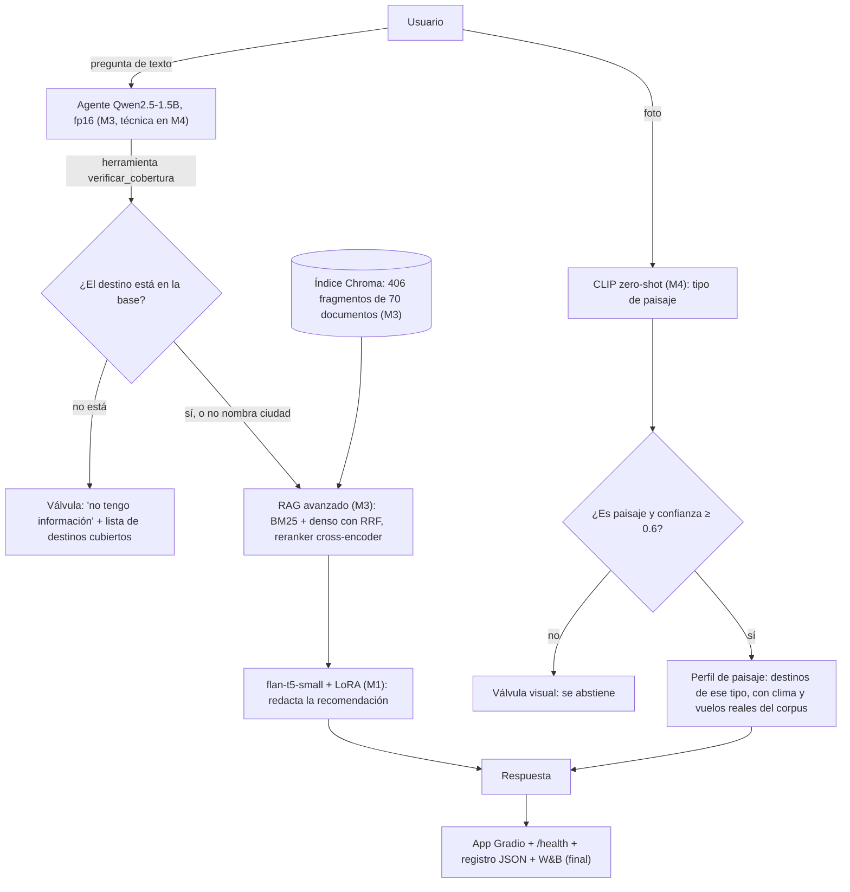

# TravelGenie: reporte final

**Equipo:** Alexandra Hurtado y Mariana Valderrama · **Curso:** STAI (SI4006), EAFIT
**Repositorio:** https://github.com/alexahurtado08/TravelGenie_AlexandraHurtado_MarianaValderrama
**Observabilidad (W&B):** https://wandb.ai/mvalderramacasta12-universidad-eafit/travelgenie-final (proyecto privado; capturas en `final/capturas/`)
**Demo:** el enlace público se genera al lanzar la app y se entrega el día de la sustentación (ver sección 5).

---

## 1. El problema y el usuario

**Quién es.** Una persona que planea un viaje dentro de Colombia y no sabe a qué destino ir ni en qué mes. Hoy tiene que cruzar
por su cuenta el clima, los precios de los vuelos, los hoteles, los restaurantes y los atractivos, en páginas distintas.

**Qué decide con el sistema.** A qué destino viajar y en qué mes. Puede preguntar con texto ("¿cuál es el mejor mes para viajar a Santa Marta?")
o con una foto de un paisaje que le gusta ("quiero algo así"); en el segundo caso el sistema le propone destinos de ese tipo.

**Qué métrica importa para esa decisión (no solo para el modelo).** Una recomendación equivocada cuesta más que una respuesta que dice
"no tengo información": un viajero que compra un vuelo por un dato inventado pierde dinero. Por eso la métrica de éxito es:

1. que la respuesta use **solo** los datos de la base y dé el mes, el precio y el origen correctos (dimensión 3 del harness: reglas de verificación propias);
2. que, cuando el destino **no** está cubierto, el sistema lo diga en lugar de inventar (`fuera de corpus: admite 4/4`);
3. con fotos, que acierte el tipo de paisaje y que **se abstenga** cuando la imagen no es un paisaje (abstención correcta 4/4).

La similitud con una respuesta de referencia y la puntuación del juez automático se reportan, pero no se usan para decidir: ver sección 6.

---

## 2. El sistema en un diagrama



| Pieza | Módulo | Archivo |
|---|---|---|
| Datos (14 destinos), corpus e índice | M1, M3 | `data/`, `data_pipeline/` |
| Generador flan-t5-small con LoRA | M1 | `travelgenie-lora-adapter/` |
| Harness de evaluación (v2) | M2 | `harness.py`, `rubrica_juez.md`, `verificacion.py` |
| RAG básico y avanzado, agente | M3 | `rag_naive.py`, `rag_avanzado.py`, `agente.py` |
| Componente visual y sus casos con imagen | M4 | `final/vision.py`, `final/perfil_paisaje.py`, `final/eval_vision.py` |
| Técnica de eficiencia | M4 | `final/eficiencia.py`, `final/eval_agente_decisiones.py` |
| App, health check, registros y W&B | final | `final/app.py`, `final/observabilidad.py` |

---

## 3. Decisiones técnicas y alternativas descartadas

| Decisión | Elegido | Alternativa descartada y por qué |
|---|---|---|
| **Modelo base** (M1) | flan-t5-small (codificador-decodificador) con LoRA | Un modelo solo codificador (tipo BERT) no genera texto libre. Un modelo solo decodificador sí podría, pero la tarea es de datos a texto con entrada corta y estructurada y salida larga, que encaja con el codificador-decodificador. |
| **Recuperación** (M3) | Búsqueda híbrida (BM25 + embeddings multilingües, fusión RRF) y reranker `mmarco-mMiniLMv2` | Solo vectores (RAG básico): en la ablación cumple el criterio en 50% de los casos frente a 83.3% con híbrida + reranking y no admite ninguna pregunta sin datos. |
| **Cómo decir "no sé" en texto** (M3) | Un agente Qwen2.5-1.5B con la herramienta `verificar_cobertura` | Solo el umbral de distancia del RAG: admite 3 de 4 preguntas sin datos; con el agente, 4 de 4. |
| **Patrón visual** (M4) | CLIP zero-shot → tipo de paisaje → destinos de ese tipo con datos reales del corpus | Entrenar un clasificador: no hay fotos etiquetadas de nuestros destinos y no se justifica el costo. Un modelo multimodal que describa la foto: es pesado para el hardware gratuito y generaría texto que no está en nuestra base. Con CLIP la respuesta sale siempre de datos verificados. |
| **Técnica de eficiencia** (M4) | Cuantizar el agente de fp32 a fp16 | int8, nf4 y bf16: no cumplieron la ganancia fijada de antemano (sección 4). |
| **Cómo mostrar la demo** (final) | `app.py` en Colab con un túnel público (cloudflared) | Hugging Face Spaces: ahora exige suscripción PRO para Gradio en CPU gratuita (error 402). El profesor aceptó la alternativa del túnel. |

Detalle de M1 a M3 en el README y en los reportes de cada módulo (wiki).

---

## 4. Técnica de eficiencia: cuantización del agente (fp32 → fp16)

**Componente elegido:** el agente Qwen2.5-1.5B, que es el que más memoria ocupa (6.2 GB en fp32).

**Lo que aceptábamos perder, fijado antes de medir** (encabezado de `final/eficiencia.py`):
la vía del agente no pierde más de 1 caso de 40 frente a fp32; la válvula no pierde nada; y se gana al menos 25% en el p95 del agente,
o 40% de memoria con un p95 no peor en más de 10%. Dicho como lo pide el PDF: aceptamos perder hasta 1 caso de 40 (unos 2.5 puntos) en el acierto de la vía y nada en las válvulas, a cambio de bajar el p95 del agente un 25% o la memoria un 40%. En la práctica no se perdió ninguno.

**Antes y después** (misma sesión de Colab, GPU T4, mismo eval set de 12 casos y mismo harness con el mismo juez):

| Versión | Calidad (harness: similitud / juez / cumple dominio) | p50 | p95 | Memoria del agente |
|---|---|---|---|---|
| Antes: fp32 | 0.599 / 3.00 / 91.7% | 2.42 s | 7.29 s | 6.18 GB |
| Después: fp16 | 0.599 / 3.00 / 91.7% | 1.88 s | 7.09 s | 3.09 GB |
| Cambio | sin cambio (las 12 respuestas salieron idénticas) | −22% | −3% | −50% |

**Solo el agente** (40 casos de decisión, `final/resultados_eficiencia.csv`):

| Variante | Acierto de la vía | Acuerdo con fp32 | p50 | p95 | Memoria | ¿Se adopta? |
|---|---|---|---|---|---|---|
| fp32 (base) | 0.825 | 1.000 | 2.10 s | 2.46 s | 6.18 GB | referencia |
| bf16 | 0.825 | 1.000 | 2.77 s | 3.17 s | 3.09 GB | no: más lento que fp32 |
| **fp16** | 0.825 | 1.000 | **1.43 s** | **1.77 s** | **3.09 GB** | **sí** |
| int8 | 0.850 | 0.975 | 9.23 s | 9.91 s | 1.78 GB | no: 4 veces más lento |
| nf4 | 0.800 | 0.875 | 2.85 s | 3.43 s | 1.12 GB | no: pierde un caso y no gana velocidad |

**¿Se cumplió?** Sí. Calidad sin pérdida, memoria −50% y p95 del agente −28% (2.46 → 1.77 s).

**Lo que no hay que sobrevender.**
- En la aplicación completa la mejora es real en la mediana (−22%) y pequeña en la cola (−3% en el harness; −6% en otra medición de 36 corridas, `final/resultados_eficiencia_e2e.csv`). Con 12 y 36 mediciones el p95 es ruidoso. La cola de unos 7 s son las preguntas que pasan por la recuperación y la generación con flan-t5, donde el agente pesa poco.
- Antes de la técnica la app cargaba el agente en **bf16**, porque con transformers 5 el modelo se carga en la precisión del checkpoint si no se indica otra. Frente a ese punto de partida real, fp16 baja la mediana de 3.00 a 1.76 s (−41%) y el p95 de 8.66 a 7.44 s (−14%) en las 36 corridas.
- La ganancia depende de la GPU: la T4 tiene núcleos fp16. En CPU fp16 no es rápido y la app usa fp32.
- int8 y nf4 se cargaron con las partes no cuantizadas en bf16, lo que añade conversiones y pudo empeorarlas. No cambia la decisión, porque estaban lejos de la ganancia, pero es una limitación de la comparación.

**Pruebas que no miden exactitud, repetidas con fp16:**
- *Válvula del agente:* acierto en `sin_cobertura` de 100% y en `fuera de tema` de 37.5%, igual que con fp32 (ver errores 3 y 4).
- *Casos adversariales del eval set:* el mismo cumplimiento (91.7%) y las mismas respuestas.
- *Invarianza:* la del componente visual no cambia, porque la técnica no lo toca.

---

## 5. Despliegue y producción verificable

**Cómo se usa.** `python final/app.py` levanta una app Gradio con dos pestañas (pregunta y foto de un paisaje). En Colab se expone con un túnel
público de cloudflared (celdas en el README). El servicio tiene que estar corriendo durante la sustentación; la URL cambia en cada lanzamiento.

**Por qué no está en Hugging Face Spaces.** Al crear el Space, la plataforma respondió `402 Payment Required`: alojar Gradio en CPU gratuita requiere PRO.
Le consultamos al profesor y aceptó correr la app en Colab con enlace público. El código para publicarla (`final/desplegar_space.py`) quedó en el repositorio, pero **no se probó**
porque la creación del Space se bloqueó. No quedó fuera ningún componente: la versión de Colab incluye texto, imagen y todas las válvulas.

**Health check.** `GET /health` responde `200` con `{"status":"ok","texto":true,"vision":true,...}` cuando los modelos cargaron, y `503` mientras cargan.
No hace ninguna pregunta real.

**Registro por petición (JSON, sin datos personales).** Un registro por solicitud con la hora, la latencia, los componentes usados (`agente+herramienta+rag`, `vision+corpus`),
si se activó la válvula y la vía. No se guarda el texto de la pregunta, la imagen, la respuesta ni la IP: `final/observabilidad.py` solo deja pasar una lista de campos permitidos.
Muestra real de una sesión de 7 solicitudes: `final/muestra_log.jsonl`.

**Observabilidad en W&B.** La app envía a W&B (si hay clave) la latencia de cada solicitud, el uso de la válvula, la tasa de errores y la confianza visual.
Capturas de la sesión de prueba en `final/capturas/` (7 solicitudes, válvula activa en 3, 0 errores).

**Latencias observadas en la sesión de la demo** (modelos ya cargados): texto con RAG de 5 a 10 s, texto rechazado por la válvula de 1.5 s, foto de 0.17 a 0.22 s (la primera foto, 1.7 s, calienta el modelo).

---

## 6. Evaluación

### Tabla evolutiva (mismo eval set de 12 casos y mismo harness; latencia = mediana)

| Sistema | Dimensiones del harness (similitud / juez / cumple dominio) | Casos con imagen | Latencia mediana |
|---|---|---|---|
| Línea base del Módulo 2 (LoRA sin RAG) | 0.484 / 3.50 / 0.0% | no aplica | 1.32 s |
| Sistema del Módulo 3 (agente + RAG avanzado) | 0.599 / 3.00 / 91.7% | no aplica | 2.76 s |
| Sistema del Módulo 4 (M3 + componente visual, agente en fp32) | 0.599 / 3.00 / 91.7% | 16/16 en test; 6/8 en difíciles | 2.42 s (texto); 0.17 s (imagen) |
| Sistema final (M4 con agente en fp16, desplegado) | 0.599 / 3.00 / 91.7% | 16/16 en test; 6/8 en difíciles | 1.88 s (texto); 0.17 s (imagen) |

- El componente visual no cambia las dimensiones del harness de texto: se evalúa aparte con sus propias fotos.
- La fila del Módulo 3 se midió en otra sesión de Colab. La comparación válida para la técnica son las dos últimas filas (misma sesión y misma máquina).
- La similitud y el juez **no** siguen la mejora real (la línea base sin RAG tiene el mejor puntaje del juez con 0% de respuestas correctas), por eso la dimensión 3 es la que decide.
  El juez automático es un modelo pequeño (Qwen2.5-1.5B) con sesgo de longitud conocido: la mitigación probada no lo eliminó (correlación 0.06 sin mitigación y 0.34 con ella).

### Ablaciones

Una **ablación** consiste en quitar una pieza del sistema, dejando todo lo demás igual, y medir cuánto empeora el resultado. Sirve para saber si cada pieza realmente aporta o si el sistema funcionaría igual sin ella. Aquí quitamos tres: las mejoras de recuperación y la herramienta del agente (texto), la válvula visual y la técnica de eficiencia.

**1. Qué aporta cada pieza del sistema de texto** (M3; mismo harness, mismos 12 casos):

| Sistema | Cumple dominio | Admite fuera de corpus (de 4) | Latencia mediana |
|---|---|---|---|
| RAG básico | 50.0% | 0 | 5.04 s |
| + solo búsqueda híbrida | 58.3% | 0 | 4.99 s |
| + solo reranking | 75.0% | 3 | 1.10 s |
| RAG avanzado (híbrida + reranking) | 83.3% | 3 | 1.14 s |
| **Agente (con herramienta)** | **91.7%** | **4** | 2.76 s |

Quitar la herramienta cuesta una pregunta sin datos admitida (de 4 a 3) y 8.4 puntos de cumplimiento.

**2. Qué aporta la válvula visual** (`final/eval_vision.py --test`, 16 fotos de test: 12 paisajes y 4 que no lo son):

| | Con válvula (umbral 0.6) | Sin válvula |
|---|---|---|
| Acierto del tipo en paisajes | 100% | 100% |
| Falsos rechazos | 0% | no aplica |
| Fotos sin paisaje rechazadas (de 4) | 4 | 0 (responde siempre, por construcción) |

En las 8 fotos difíciles el umbral decidió dos casos: la planta (confianza 0.49) y el mapa (0.54) se rechazaron solo porque quedaron por debajo de 0.6. Sin válvula el sistema habría dado destinos de selva para esas dos imágenes.

**3. Qué aporta la técnica de eficiencia:** sección 4.

### Componente visual: resultados

| Conjunto | Fotos | Resultado |
|---|---|---|
| Desarrollo (elegir el umbral) | 10 | 100% de acierto; todos los umbrales de 0.3 a 0.9 empatan, se tomó el centro: 0.6 |
| Prueba | 16 | acierto del tipo 100%, falsos rechazos 0%, abstención correcta 4/4 |
| Invarianza (volteo, 50% de tamaño, JPEG de baja calidad, brillo ±20%, recorte al 90%) | 16 | la decisión no cambia en 100% de los casos |
| Difíciles (sin ajustar nada después de verlos) | 8 | 6/8 correctos |
| Latencia (sesión final) | | p50 0.17 s, p95 0.23 s (en otra sesión, 0.28 y 0.44 s) |

Las fotos vienen de Wikimedia Commons con licencia libre; la fuente, el autor y la licencia de cada una están en `final/imagenes_prueba.csv`.

---

## 7. Análisis de errores

Fuentes: `final/resultados_eficiencia.json` (40 casos del agente), `final/resultados_vision_dificiles.json` y el harness del sistema final (`scorecard_m3_detalle_agente_fp16.json`).
"Fallo de vía" significa que la vía fue distinta de la esperada, no siempre que el usuario recibió una mala respuesta; por eso cada caso lleva su **impacto**.
Las etiquetas se escribieron antes de correr y no se cambiaron después.

### A. El agente confunde lo que es una ciudad

| # | Caso | Qué pasó | Pieza que falló | Impacto | Cómo arreglarlo |
|---|---|---|---|---|---|
| 1 | "Recomiéndame un plan de montaña barato." | Llamó a `verificar_cobertura("Montaña")`, la herramienta dijo que no hay datos y respondió "no incluye Montaña". | Agente: tomó un tipo de paisaje por una ciudad. La barrera "el destino debe estar escrito en la pregunta" no lo frena porque la palabra sí está. | **Rechazo falso** de una pregunta válida: el fallo más dañino. | Aceptar solo destinos que sean municipios colombianos (la lista DIVIPOLA ya está en `data/`). |
| 2 | "¿Qué destinos de selva recomiendan?" | Igual que el 1, con el argumento `selva`. | Agente, igual que el 1. | Rechazo falso. | Igual que el 1. |
| 3 | Perú, Francia, París, Lima, Miami (5 preguntas) | Llamó a la herramienta con ese lugar y respondió "no tengo información, mi base no incluye Francia". La etiqueta esperaba pasar al RAG. | Agente: el modelo de 1.5B no aplica la regla del prompt ("un país no es una ciudad") a partir de un solo ejemplo (hipótesis). | **Casi ninguno**: el usuario recibe una abstención honesta. Es un desajuste con la etiqueta, y explica el 37.5% en fuera de tema. El mensaje suena raro ("no incluye Francia"). | Más ejemplos en el prompt, o la validación DIVIPOLA del caso 1. |
| 4 | "Busco un destino de playa económico para diciembre." (fp32 y fp16) | El agente inventó "Playa del Carmen". | Agente: argumento inventado. | **Ninguno**: la barrera lo bloqueó porque no está en la pregunta y el agente siguió al RAG. Es un acierto de la defensa. | |
| 5 | Mismo caso, con nf4 | Llamó con el argumento `playa`, que sí está en la pregunta, y la respuesta fue `sin_cobertura`. | Agente cuantizado a 4 bits: degrada el argumento y esta vez la barrera no lo detiene. | Rechazo falso. Es el motivo por el que nf4 pierde un caso de vía. | No usar nf4 (ya descartado por la tolerancia). |
| 6 | "mejor época para visitar tunja" (minúsculas) | No llamó a la herramienta. | Agente: no reconoce el nombre sin mayúscula inicial (hipótesis). | Ninguno aquí (Tunja está cubierta y va al RAG). Riesgo: con una ciudad no cubierta en minúsculas no se activaría la válvula. | Normalizar el texto antes de pasarlo al agente. |

### B. Visión

| # | Caso | Qué pasó | Pieza que falló | Impacto | Cómo arreglarlo |
|---|---|---|---|---|---|
| 7 | Playa de Tailandia | Clasificada como playa con confianza 0.98 y respondió con destinos colombianos. | CLIP: reconoce el tipo de paisaje, no el país. La válvula no puede arreglarlo con ningún umbral. | El usuario recibe destinos de playa colombianos aunque su foto no sea de Colombia. Es un límite del enfoque. | La respuesta aclara que recomienda por tipo de paisaje y no verifica el lugar. |
| 8 | Prado alpino sin nieve (Bulgaria) | Clasificado como montaña con confianza 0.619. | Válvula: pasó el umbral (0.60) por 0.019. | Recomienda destinos de montaña para un paisaje de otra región. | La zona de 0.54 a 0.62 es frágil; harían falta más fotos difíciles para calibrar el umbral (el de desarrollo no lo informó). |

### C. Generación y recuperación (RAG)

| # | Caso | Qué pasó | Pieza que falló | Impacto | Cómo arreglarlo |
|---|---|---|---|---|---|
| 9 | "¿Qué hoteles hay en Medellín?" | La respuesta dice "…en Medelln, en el uso de MEDELLN…": pierde las tildes y el texto es poco coherente (juez 3). | Generador flan-t5-small con LoRA. **Verificado:** su tokenizador no tiene la letra í (codifica y decodifica "Medellín MEDELLÍN" como "Medelln MEDELLN"), así que la pierde en cualquier texto que genere. | Respuestas de apariencia descuidada que pueden confundir el nombre de la ciudad. | Restaurar los nombres de los destinos a partir de los datos recuperados (que sí traen la tilde), un generador con tokenizador multilingüe, o armar la respuesta con plantillas a partir de los datos, como ya hace el componente visual. |
| 10 | "Busco un destino turístico barato con buen clima, ¿qué me recomiendas?" | Respuesta "No tengo información sobre eso" (juez 1). | Válvula de distancia del RAG: rechaza consultas abiertas que no nombran un destino, porque ningún fragmento queda cerca. | El usuario con una pregunta genérica no recibe ayuda, aunque la base sí podría responder. | Una vía para preguntas abiertas que ordene los destinos por precio y clima, como hace el componente visual con los vuelos. |

**Lo que no se arregló.** No se modificó el agente ni el umbral después de ver estos resultados: son hallazgos. Arreglarlos exigiría volver a evaluar todo; la validación DIVIPOLA, además,
tiene su propio costo (una ciudad inventada como "Villa Esperanza del Sur" dejaría de ser `sin_cobertura`).

---

## 8. Limitaciones

**Dónde no hay que creerle al sistema.**
- **Precios y clima son históricos**, no ofertas actuales: sirven para elegir el mes, no para comprar.
- **Solo cubre 14 destinos.** Para cualquier otro dice que no tiene información; no extrapola.
- **La foto da el tipo de paisaje, no el lugar.** Una playa de otro país produce destinos de playa colombianos (error 7).
- **Los textos generados a veces son poco fluidos** y pierden tildes (error 9). Las cifras (mes, precio, origen) se verifican con reglas, pero la redacción no es confiable.
- **Una pregunta abierta sin ciudad puede ser rechazada** aunque la base pueda responder (error 10).

**Qué hace cuando no sabe.**
- En texto, la herramienta `verificar_cobertura` devuelve "no tengo información" con la lista de destinos cubiertos (4/4 en el eval set).
- En foto, la válvula se abstiene si la imagen no es un paisaje o la confianza es menor de 0.6 (4/4 en test).
- Ninguna de las dos válvulas es perfecta: ver errores 1, 2, 5 y 8.

**Lo que limita nuestra evaluación.**
- El eval set de texto tiene 12 casos: una diferencia de una pregunta mueve 8 puntos porcentuales. Las diferencias pequeñas no son significativas.
- El juez automático es un modelo de 1.5B con sesgo de longitud; por eso la decisión se apoya en la dimensión 3, con reglas de verificación propias.
- Las fotos de desarrollo y prueba son limpias y de Wikimedia Commons: la prueba de 16 fotos fue fácil, el umbral de 0.6 no se ejercitó y no medimos fotos de celular con mala luz.
- La latencia varía entre sesiones de Colab (la imagen midió p50 de 0.28 s y de 0.17 s); la mejora de la técnica es válida para la comparación en una misma sesión, no como cifra absoluta.
- La aplicación no genera imágenes: las respuestas con foto muestran datos del corpus, por eso no hay nada que marcar como "generado".

---

## 9. Ética

**1. ¿A quién podría fallarle más?** A quien pregunta por un destino que no cubrimos: el sistema solo conoce 14 destinos y deja fuera a Bogotá, Cartagena o San Andrés, con lo que un viajero puede creer que no existen opciones. Esto sí lo medimos (rechaza el 100% de los destinos no cubiertos). Con fotos, falla con paisajes de otros países: una playa de Tailandia salió como playa colombiana con 98% de confianza (medido en 8 casos difíciles, así que es evidencia limitada).

**2. ¿Qué pasa con los datos?** El sistema recibe preguntas de texto y fotos. No las guarda ni las registra: los registros solo llevan longitud, tipo, latencia y resultado (ver `final/muestra_log.jsonl`), y W&B recibe solo métricas numéricas. Las fotos se procesan en memoria; Gradio deja una copia temporal en el servidor que se borra en pocos minutos, y la interfaz se lo dice al usuario. Una foto puede incluir personas o la ubicación en sus metadatos: no las usamos ni las conservamos, pero el usuario es quien decide qué foto sube.

**3. ¿Qué daño haría un error?** El peor error es recomendar un precio, un mes o un hotel inventados y que alguien compre un vuelo con ese dato. Lo sufre el viajero. Para evitarlo, el agente verifica que el destino esté en la base y dice "no tengo información" si no lo está; las cifras se verifican con reglas; y con fotos, el sistema responde con datos del corpus, no con texto libre. Aun así, los precios son históricos y la decisión de compra es de la persona.

---

## 10. Quién hizo qué

- **Alexandra Hurtado:** todas las partes del proyecto, en conjunto con Mariana (datos, ajuste con LoRA, harness, RAG y agente, componente visual, técnica de eficiencia, app y despliegue, reportes y presentación). Nos reunimos para cada parte y trabajamos desde un mismo computador o, a veces, desde los dos.
- **Mariana Valderrama:** todas las partes del proyecto, en conjunto con Alexandra, con el mismo método de trabajo. Las dos podemos explicar cualquier parte del sistema.

---

## 11. Uso de IA

**Herramienta:** Claude Code (Anthropic), en sesiones de chat, durante M1, M2, M3, M4 y el proyecto final. No usamos ninguna otra herramienta de IA.

**Para qué partes:**
- **Código:** borradores de los scripts de evaluación, del componente visual, de la técnica de eficiencia, de la app y del registro de observabilidad.
- **Despliegue:** apoyo en todo el proceso de poner la app en línea: el health check, el registro JSON y la conexión con W&B; el intento de publicar en Hugging Face Spaces (y el diagnóstico del error 402); la alternativa de correr la app en Colab con un túnel público; y la preparación del script de despliegue y de las dependencias.
- **Depuración:** errores de entorno en Colab (versiones, conflictos de `git pull`), de formato de datos (el CSV de fotos), y de compatibilidad de librerías.
- **Revisión y corrección:** revisar nuestro trabajo contra la guía de cada entrega y la retroalimentación recibida. Por ejemplo, detectó que la comparación fp32 contra bf16 estaba mal etiquetada y que el sistema registraba menos campos de los que pide el PDF.
- **Análisis y redacción:** versiones iniciales del análisis de errores, las tablas y los textos del reporte y del README.

**Qué revisamos o cambiamos nosotras:** elegimos el diseño del componente visual y la fuente de las fotos; buscamos y descargamos las 34 fotos y registramos su fuente, autor y licencia; ejecutamos todas las evaluaciones en Colab; revisamos que las cifras del reporte coincidan con los archivos de resultados; creamos las cuentas de W&B y Hugging Face, pusimos las claves y levantamos nosotras la app y el túnel de la demo en Colab, siguiendo los pasos que nos indicó la herramienta; y le consultamos al profesor la alternativa de despliegue.

**Los modelos que forman parte del sistema** (flan-t5-small con LoRA, Qwen2.5-1.5B como agente y juez, CLIP y los modelos de embeddings y reranking) son componentes de TravelGenie y no cuentan como asistencia de IA.

**Responsabilidad:** el equipo es responsable de todo el contenido presentado: el código, los resultados, el reporte, las decisiones y las conclusiones.
Declaración completa: [Uso de IA](https://github.com/alexahurtado08/TravelGenie_AlexandraHurtado_MarianaValderrama/wiki/Declaraci%C3%B3n-uso-de-IA).

---

## 12. Reproducibilidad

Semilla 42 y versiones fijadas en `requirements.txt` (la app añade `gradio==5.49.1`, `pillow` y `wandb`). Sin claves de pago: el agente, el juez y RAGAS son el mismo Qwen2.5-1.5B local; W&B es opcional (variable `WANDB_API_KEY`, nunca en el repositorio).

```
!git clone https://github.com/alexahurtado08/TravelGenie_AlexandraHurtado_MarianaValderrama
%cd TravelGenie_AlexandraHurtado_MarianaValderrama
!pip install -q -r requirements.txt
!pip install -q gradio==5.49.1 pillow wandb bitsandbytes
!python data_pipeline/paso9_indexar_chroma.py          # reconstruye chroma_db/ (no se versiona)
!python correr_m3.py agente_fp32                       # antes de la técnica
!python correr_m3.py agente_fp16                       # después
!python final/eficiencia.py --decisiones               # las 5 variantes, 40 casos
!python final/eficiencia.py --e2e fp32 bf16 fp16 --repeticiones 3
!python final/eval_vision.py --tune                    # elige el umbral con las fotos de desarrollo
!python final/eval_vision.py --test                    # 16 fotos de prueba
!python final/eval_vision.py --dificiles               # 8 casos límite
!python final/app.py                                   # la app (puerto 7860, /health)
```
